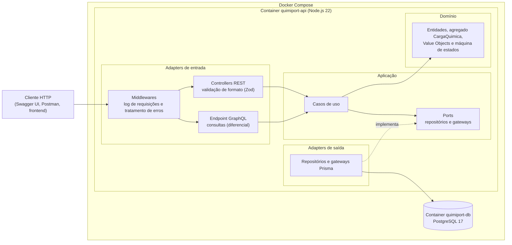
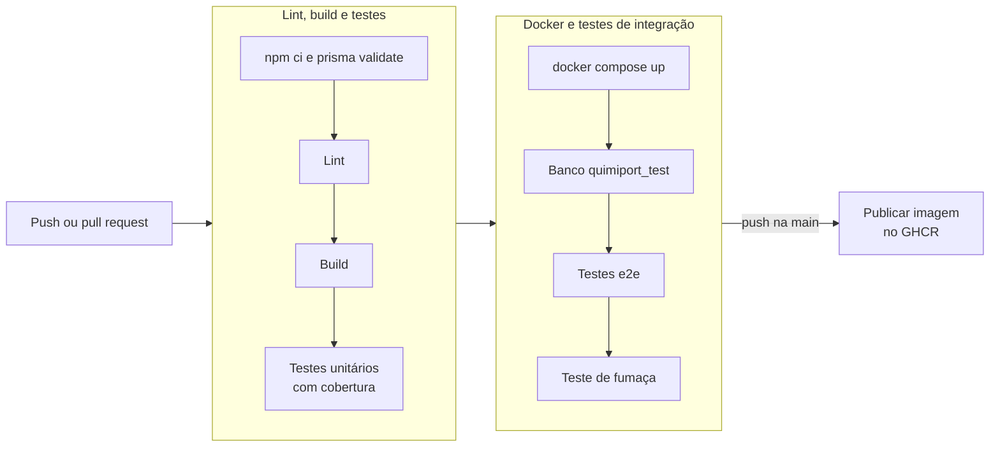
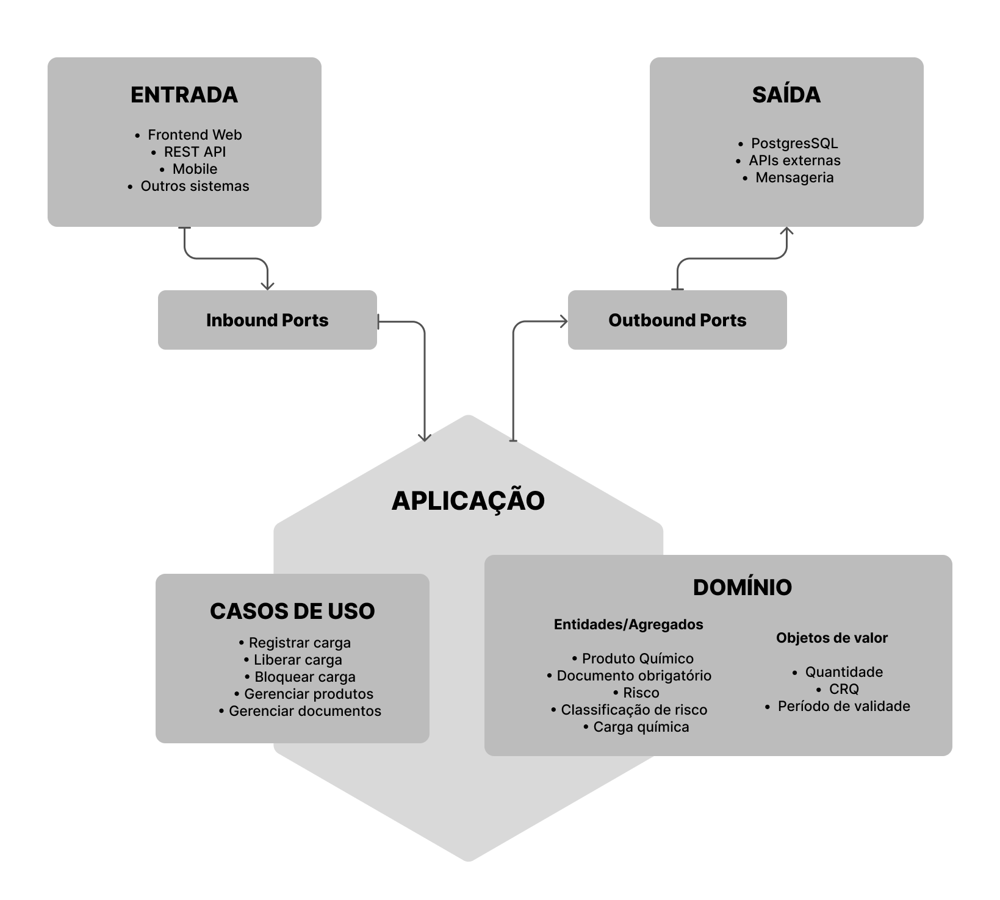

# Arquitetura e ADRs

## Arquitetura adotada

A **Arquitetura Hexagonal**, que atua com Ports e Adapters, tem o objetivo de separar as responsabilidades da aplicação, reduzir o acoplamento entre as camadas e facilitar sua evolução ao longo das próximas etapas do projeto. Por esse motivo, esse foi o modelo de arquitetura adotado para desenvolvermos o QuimiPort.

### Benefícios e tradeoffs

Nesse cenário, as regras de negócio serão concentradas no domínio da aplicação. Isso garante que as regras permaneçam independentes da infraestrutura utilizada no sistema. Como tradeoff, isso exige um esforço maior ao modelar e definir essas abstrações no início do desenvolvimento.

## Evolução do projeto

No caso da arquitetura Hexagonal, cada módulo pode ser incluído como um novo caso de uso no núcleo da aplicação, reutilizando entidades e regras de negócio já existentes. Desse modo, é possível adicionar novas funcionalidades sem alterar o domínio da aplicação

### Backend

Possíveis soluções avaliadas na Fase 1:

- Node.js com Express
- Spring Boot (Java)
- ASP .NET Core (.NET)

A solução adotada foi Node.js com Express, conforme a [ADR-003](#adr-003--backend-com-nodejs-e-express).

### Frontend

O frontend será desenvolvido utilizando React, permitindo a construção de uma interface modular e componentizada. A aplicação consumirá os recursos disponibilizados pelo backend, mantendo a camada de apresentação desacoplada das regras de negócio do domínio.

### Mobile

A aplicação mobile será desenvolvida utilizando React Native, possibilitando o reaproveitamento de conhecimentos e conceitos utilizados no frontend web. Essa escolha também permite que a solução seja expandida para dispositivos móveis sem alterar o núcleo de regras de negócio da aplicação.

### Microsserviços

À medida que o sistema crescer, alguns contextos poderão ser extraídos para serviços independentes, como:

- Serviço de Gestão de Produtos Químicos;
- Serviço de Gestão de Cargas;
- Serviço de Documentação;
- Serviço de Inspeções;
- Serviço de Notificações.

## Estrutura de pastas

Cada módulo corresponde a um contexto do domínio e é dividido nas camadas de domínio, aplicação e infraestrutura. O módulo `cargas` é o mais completo e serve de referência para os demais:

```
src/
│
├── modules/
│   │
│   ├── cargas/
│   │   ├── domain/
│   │   │   ├── aggregates/        # CargaQuimica (agregado raiz) e máquina de estados
│   │   │   ├── value-objects/     # StatusCarga, Quantidade, UnidadeMedida
│   │   │   └── events/            # Eventos do histórico da carga
│   │   │
│   │   ├── application/
│   │   │   ├── use-cases/         # Registrar, listar, buscar, atualizar status, bloquear, liberar, cancelar
│   │   │   ├── dto/
│   │   │   └── ports/             # Repositório da carga e gateways de produto e usuário
│   │   │
│   │   └── infrastructure/
│   │       ├── adapters/
│   │       │   ├── inbound/http/  # Controller e schemas de validação (Zod)
│   │       │   └── outbound/      # Gateways que consultam produtos e usuários via Prisma
│   │       ├── persistence/       # Repositório Prisma
│   │       └── cargas.module.ts   # Composição do módulo e rotas
│   │
│   ├── produtos/
│   │   ├── domain/
│   │   │   ├── entities/          # ProdutoQuimico
│   │   │   └── value-objects/     # ClasseRisco, GrupoCompatibilidade, EstadoFisico, StatusProduto
│   │   ├── application/
│   │   │   ├── use-cases/
│   │   │   ├── dto/
│   │   │   └── ports/
│   │   └── infrastructure/
│   │       ├── adapters/inbound/http/
│   │       ├── persistence/
│   │       └── produtos.module.ts
│   │
│   └── usuarios/
│       ├── domain/
│       │   ├── entities/          # Usuario
│       │   └── value-objects/     # Cpf, Senha, CargoProfissional, StatusUsuario
│       ├── application/
│       │   ├── use-cases/
│       │   ├── dto/
│       │   └── ports/             # Repositório e hash de senha
│       └── infrastructure/
│           ├── adapters/
│           │   ├── inbound/http/
│           │   └── outbound/      # Hash de senha com scrypt
│           ├── persistence/
│           └── usuarios.module.ts
│
├── shared/
│   ├── domain/                    # Erros de domínio e base dos valores enumerados
│   ├── application/               # Paginação
│   ├── config/                    # Variáveis de ambiente
│   └── infrastructure/
│       ├── database/              # Instância do Prisma Client
│       ├── graphql/               # Schema e handler das consultas GraphQL (diferencial)
│       ├── http/                  # Middlewares, validação, OpenAPI e registro de eventos
│       └── logging/               # Logger estruturado
│
├── app.ts                         # Montagem da aplicação Express
└── main.ts                        # Inicialização do servidor
```

Os módulos `inspecoes` e `documentacao`, previstos na Fase 1, ainda não foram implementados. Nesta fase, a documentação obrigatória é representada na carga pelo campo `documentacaoValida`, e as tabelas `documentos_carga` e `inspecoes` já existem no banco para a evolução prevista na [Modelagem de dados](./08-modelagem-de-dados.md#12-como-os-dados-poderão-evoluir-nas-próximas-fases).

Fora do `src/`, o projeto contém:

```
database/schema.sql      # Script de criação do banco
prisma/schema.prisma     # Models do Prisma, espelhando o schema.sql
test/api/                # Testes de integração (e2e) da API
scripts/smoke-test.mjs   # Teste de fumaça usado no pipeline
.github/workflows/       # Pipeline de CI/CD
Dockerfile               # Imagem da API
docker-compose.yml       # API e PostgreSQL
```

## Arquitetura implementada na Fase 2

O diagrama abaixo mostra o caminho de uma requisição pelas camadas da aplicação e os containers em que ela é executada:



O pipeline de CI/CD executa as etapas abaixo a cada push ou pull request para a `main`:



## Camadas da aplicação



### Domínio

Responsável por representar os conceitos e regras centrais do QuimiPort.

Contém:

- Entidades;
- Agregados;
- Value Objects;
- Regras de negócio;
- Serviços de domínio;
- Eventos de domínio, quando aplicável.

O domínio não possui dependência de banco de dados, frameworks, APIs externas ou interfaces de usuário.

### Aplicação

Responsável por orquestrar os casos de uso do sistema.

Contém:

- Casos de uso;
- DTOs;
- Interfaces das Ports;
- Orquestração das operações.

A camada de aplicação utiliza o domínio para executar as operações e acessa recursos externos exclusivamente por meio das Ports.

### Ports

As Ports definem os contratos utilizados para comunicação entre o núcleo da aplicação e o ambiente externo.

#### Inbound Ports

Representam os contratos de entrada dos casos de uso.

Implementados como classes de caso de uso, por exemplo:

- RegistrarCargaQuimica;
- LiberarCarga;
- BloquearCarga;
- BuscarCargaQuimica.

#### Outbound Ports

Representam os contratos necessários para acessar recursos externos.

Implementados nesta fase:

- CargaQuimicaRepository;
- ProdutoQuimicoRepository;
- UsuarioRepository;
- ProdutoQuimicoGateway e UsuarioGateway, usados pelo módulo de cargas para consultar produtos e usuários;
- HashSenha.

Previstos para as próximas fases: DocumentoRepository e StorageGateway, para o anexo de documentos às cargas.

### Adapters

Os Adapters implementam a comunicação com tecnologias externas.

#### Adapters de entrada

- Controllers REST;
- Interfaces de API;
- Futuramente, aplicações web e mobile.

#### Adapters de saída

- PostgreSQL;
- Serviços de armazenamento de arquivos;
- APIs externas;
- Serviços de mensageria, quando necessários.

### Infraestrutura

Responsável pelas implementações concretas dos recursos externos e configurações técnicas da aplicação.

Essa camada não deve conter regras de negócio.

## JavaScript Avançado e TypeScript

O QuimiPort utilizará TypeScript e recursos modernos do JavaScript para garantir uma aplicação mais segura, organizada e preparada para evolução. A tipagem forte será utilizada para representar os conceitos do domínio de forma clara, enquanto interfaces, classes e tipos específicos ajudarão a manter contratos bem definidos entre os componentes.

### Tipagem 

O TypeScript será utilizado para representar explicitamente os conceitos do domínio, evitando o uso excessivo de tipos genéricos. Isso contribui para reduzir erros, facilitar a manutenção e tornar os contratos da aplicação mais claros.

```ts
interface CargaQuimica {
  id: string;
  quantidade: Quantidade;
  status: StatusCarga;
}
```

### Interfaces

As interfaces serão utilizadas principalmente para definir contratos entre componentes, especialmente nas **Ports** da Arquitetura Hexagonal. Dessa forma, a aplicação não ficará diretamente acoplada às implementações de infraestrutura.

```ts
interface CargaRepository {
  buscarPorId(id: string): Promise<CargaQuimica>;
  salvar(carga: CargaQuimica): Promise<void>;
}
```

### Classes

As classes serão utilizadas quando um objeto possuir comportamento e regras próprias, principalmente em entidades, agregados e Value Objects do domínio. Dessa forma, as regras de negócio podem ser protegidas pelo próprio domínio.

Por exemplo, em vez de alterar diretamente o status de uma carga, a entidade poderá controlar a operação:

```ts
carga.liberar();
```

### Enums e tipos para status e classificações

Valores que possuem um conjunto previamente definido serão representados por tipos específicos, evitando valores arbitrários e facilitando a validação durante o desenvolvimento.

```ts
type StatusCarga =
  | 'REGISTRADA'
  | 'BLOQUEADA'
  | 'LIBERADA'
  | 'CANCELADA';
```

Essa abordagem será aplicada principalmente a status, classificações de risco e outros estados controlados pelo domínio.

### Funções puras para validações

Validações que não dependem de estado externo poderão ser implementadas como funções puras. Isso torna seu comportamento previsível e facilita a criação de testes unitários.

```ts
function quantidadeValida(valor: number): boolean {
  return valor > 0;
}
```

### Módulos ES6+

A aplicação será organizada utilizando módulos ES6+, com `import` e `export`, mantendo cada parte do sistema com responsabilidades bem definidas. Essa organização contribui para o baixo acoplamento e facilita a reutilização dos componentes.

### Async/Await

O `async/await` será utilizado em operações assíncronas, principalmente em futuras integrações com APIs, bancos de dados e outros serviços externos. A abordagem facilita a leitura do código e o tratamento de erros em operações assíncronas.

### Generics

Generics serão utilizados quando houver necessidade de criar estruturas reutilizáveis que mantenham a tipagem dos dados. Seu uso será aplicado de forma pontual, evitando complexidade desnecessária.

### Tratamento de erros

Os erros serão tratados de forma consistente, diferenciando erros relacionados às regras de negócio de falhas de infraestrutura ou integração. No domínio, regras inválidas poderão gerar erros específicos, enquanto as camadas externas serão responsáveis por traduzir esses erros para respostas adequadas.

### Contratos e tipos compartilhados

Os contratos e tipos utilizados por diferentes partes da aplicação serão organizados de forma centralizada e controlada, evitando duplicação e divergência entre componentes. Essa organização será especialmente importante para as interfaces das Ports e para os contratos de comunicação entre módulos.

## ADRs (Architecture Decision Record)

### ADR-001 — Adoção da Arquitetura Hexagonal

**Status:** Aceito

#### Contexto

O QuimiPort deverá evoluir ao longo das próximas fases, podendo incorporar diferentes interfaces, integrações e componentes de infraestrutura. É necessário evitar que as regras de negócio fiquem acopladas às tecnologias utilizadas.

#### Decisão

Adotar a **Arquitetura Hexagonal (Ports and Adapters)** como arquitetura estrutural da aplicação.

#### Alternativas consideradas

- Arquitetura em camadas tradicional;
- Clean Architecture;
- Onion Architecture.

#### Justificativa

A Arquitetura Hexagonal permite manter o domínio isolado e definir contratos para comunicação com componentes externos, reduzindo o acoplamento entre regras de negócio e infraestrutura.

#### Consequências

**Positivas:**
- Maior isolamento do domínio;
- Facilidade para testes unitários;
- Menor acoplamento com infraestrutura;
- Facilidade para substituir implementações externas.

**Negativas:**
- Maior quantidade inicial de abstrações;
- Necessidade de definir e manter Ports e Adapters.

### ADR-002 — Uso do TypeScript

**Status:** Aceito

#### Contexto

O projeto possui um domínio com entidades, estados, classificações e contratos que precisam ser representados de forma consistente.

#### Decisão

Utilizar **TypeScript** como linguagem principal da aplicação.

#### Alternativas consideradas

- JavaScript;
- TypeScript.

#### Justificativa

A tipagem estática permite representar os conceitos do domínio com maior segurança e reduzir erros durante o desenvolvimento.

#### Consequências

**Positivas:**
- Tipagem forte;
- Melhor manutenção;
- Contratos explícitos;
- Maior segurança durante o desenvolvimento.

**Negativas:**
- Maior complexidade inicial;
- Necessidade de configuração e compilação.

### ADR-003 — Backend com Node.js e Express

**Status:** Aceito

#### Contexto

O backend precisa expor os casos de uso do QuimiPort por meio de uma API HTTP, mantendo o domínio e a camada de aplicação independentes do framework utilizado, conforme definido na ADR-001.

#### Decisão

Utilizar **Node.js com Express** para o desenvolvimento do backend.

#### Alternativas consideradas

- NestJS;
- Fastify.

#### Justificativa

O Express é um framework minimalista, que não impõe uma estrutura própria de módulos, decorators ou injeção de dependências. Dessa forma, a organização do projeto fica a cargo da Arquitetura Hexagonal, e o framework fica restrito aos Adapters de entrada (rotas e controllers REST), sem alcançar o domínio ou os casos de uso. O Node.js mantém o ecossistema alinhado ao TypeScript utilizado no projeto.

#### Consequências

**Positivas:**
- Baixo acoplamento entre o framework e o núcleo da aplicação;
- Menor quantidade de abstrações e convenções a serem aprendidas;
- Ecossistema consolidado, com ampla documentação e comunidade;
- Facilidade de implementação e teste de APIs.

**Negativas:**
- Necessidade de organizar manualmente a estrutura de pastas, a injeção de dependências e a composição dos módulos;
- Ausência de recursos nativos de validação, que precisarão ser tratados por bibliotecas complementares ou pelo próprio domínio;
- Dependência do ecossistema Node.js/Express na infraestrutura.

### ADR-004 — Frontend com React

**Status:** Aceito

#### Decisão

Adotar o **React** para o desenvolvimento da aplicação web.

#### Justificativa

O React permite construir uma interface componentizada e manter a camada de apresentação separada do domínio da aplicação.

#### Consequências

**Positivas:**
- Componentização;
- Ecossistema consolidado;
- Facilidade de evolução da interface.

**Negativas:**
- Dependência do ecossistema React;
- Verbosidade de código ao compará-lo a frameworks similares

### ADR-005 — Banco de dados PostgreSQL

**Status:** Aceito

#### Contexto

A Fase 2 exige a persistência de produtos químicos e cargas químicas, com associação entre carga e produto, consultas básicas, atualizações e inativação ou cancelamento lógico. O enunciado permite um banco relacional ou não relacional.

#### Decisão

Utilizar o **PostgreSQL 17** como banco de dados da aplicação.

#### Alternativas consideradas

- MongoDB;
- MySQL.

#### Justificativa

Os dados do QuimiPort têm estrutura fixa e são fortemente relacionados: toda carga referencia um produto e um responsável técnico, e o histórico pertence a uma carga e a um autor. As chaves estrangeiras e as transações ACID garantem no próprio banco a integridade dessas referências e a gravação conjunta da mudança de status e do evento de histórico. A análise completa está na [Modelagem de dados](./08-modelagem-de-dados.md#3-banco-de-dados-escolhido).

#### Consequências

**Positivas:**
- Integridade referencial garantida pelo banco;
- Atomicidade entre a mudança de status e o histórico da carga;
- Enums, CHECKs e triggers reforçam as regras mais críticas;
- Novas funcionalidades entram como novas tabelas, sem reestruturar os dados existentes.

**Negativas:**
- Alterações de estrutura exigem atualizar o script do banco;
- Menor flexibilidade para dados heterogêneos, caso surjam.

### ADR-006 — Acesso ao banco com Prisma

**Status:** Aceito

#### Contexto

Os repositórios da camada de infraestrutura precisam acessar o PostgreSQL de forma tipada, sem que o domínio e os casos de uso dependam da tecnologia de persistência (ADR-001).

#### Decisão

Utilizar o **Prisma ORM** nos repositórios e gateways de saída. O banco é criado pelo script `database/schema.sql`, e o `prisma/schema.prisma` espelha esse script.

#### Alternativas consideradas

- TypeORM;
- Knex;
- Driver `pg` com SQL puro.

#### Justificativa

O Prisma gera um client tipado a partir do schema, o que mantém os repositórios alinhados ao TypeScript (ADR-002). Manter o `schema.sql` como fonte da estrutura permite usar recursos que o Prisma não representa, como CHECKs, índice único parcial e os triggers que tornam o histórico imutável.

#### Consequências

**Positivas:**
- Consultas tipadas e com autocompletar;
- Suporte a transações para gravar a carga e o histórico juntos;
- Prisma restrito à infraestrutura, sem alcançar o domínio.

**Negativas:**
- Dois arquivos de estrutura (`schema.sql` e `schema.prisma`) que precisam ser mantidos em sincronia;
- Necessidade de gerar o client antes de compilar e testar.

### ADR-007 — Validação de entrada com Zod e regras no domínio

**Status:** Aceito

#### Contexto

A API recebe dados que precisam ser validados em dois níveis: o formato da requisição (campos obrigatórios, tipos, paginação) e as regras de negócio (classe de risco válida, produto ativo, quantidade positiva, transições de status).

#### Decisão

Utilizar o **Zod** apenas nos adapters HTTP, para validar o formato da requisição. As regras de negócio e a lista de valores permitidos ficam nas entidades, agregados e Value Objects do domínio.

#### Alternativas consideradas

- Validar tudo com Zod;
- class-validator;
- Validação manual nos controllers.

#### Justificativa

Separar os dois níveis mantém as regras de negócio em um único lugar, testáveis sem HTTP e sem banco, como prevê a Arquitetura Hexagonal. O Zod fica restrito à borda da aplicação e pode ser substituído sem afetar o domínio.

#### Consequências

**Positivas:**
- Regras de negócio concentradas e reutilizadas por todos os pontos de entrada;
- Erros de formato e de regra retornam códigos HTTP distintos (400 e 422);
- Domínio independente de bibliotecas de validação.

**Negativas:**
- Alguns campos são verificados nos dois níveis;
- Necessidade de manter os schemas HTTP alinhados aos DTOs.

### ADR-008 — Logs estruturados

**Status:** Aceito

#### Contexto

A Fase 2 exige uma estratégia inicial de logs que ajude a compreender o funcionamento da API e a identificar problemas, registrando requisições, erros e operações relevantes, como criação de produtos, registro de cargas e alterações de status.

#### Decisão

Utilizar um **logger próprio**, sem dependências externas, que grava cada evento em uma linha com timestamp, nível, mensagem e dados em JSON. Um middleware registra o início e a conclusão de cada requisição, com um `requestId`, e os controllers registram os eventos de negócio com o mesmo `requestId`.

#### Alternativas consideradas

- Pino;
- Winston;
- `console.log` sem padronização.

#### Justificativa

O volume de logs desta fase não exige os recursos de uma biblioteca dedicada. O formato estruturado e o `requestId` permitem relacionar a requisição aos eventos de negócio que ela gerou, e a interface do logger permite trocar a implementação por uma biblioteca nas próximas fases.

#### Consequências

**Positivas:**
- Nenhuma dependência adicional;
- Logs legíveis no terminal e com dados estruturados;
- Rastreio de cada requisição pelo `requestId`.

**Negativas:**
- Sem recursos de bibliotecas dedicadas, como níveis configuráveis e envio para serviços externos;
- Integração com ferramentas de observabilidade, como Prometheus e Grafana, fica para as próximas fases.

### ADR-009 — Documentação da API com OpenAPI e Swagger

**Status:** Aceito

#### Contexto

A API precisa ser documentada com a lista de endpoints, métodos, parâmetros, exemplos de request e response, códigos de erro e regras aplicadas.

#### Decisão

Descrever a API em uma especificação **OpenAPI 3**, servida em `/openapi.json` e exibida pelo **Swagger UI** em `/docs`.

#### Alternativas consideradas

- Redoc;
- Collection do Postman ou do Insomnia;
- Documentação apenas no README.

#### Justificativa

O Swagger UI permite consultar e testar os endpoints no navegador, com a aplicação em execução. A especificação OpenAPI é um padrão aberto, que pode ser importado no Postman e no Insomnia. Os valores de enum da especificação são importados dos Value Objects do domínio, o que mantém a documentação alinhada às regras do código.

#### Consequências

**Positivas:**
- Documentação interativa disponível junto com a API;
- Padrão aceito por diversas ferramentas;
- Enums sincronizados com o domínio.

**Negativas:**
- A especificação é escrita manualmente e precisa ser atualizada a cada mudança nos endpoints.

### ADR-010 — Containers com Docker e Docker Compose

**Status:** Aceito

#### Contexto

A aplicação deve ser executada de forma padronizada, sem depender da configuração manual do ambiente de cada integrante.

#### Decisão

Utilizar um **Dockerfile multi-stage** para a imagem da API e o **Docker Compose** para subir a API e o PostgreSQL. O banco é criado pelo `schema.sql` na primeira inicialização, e a API só sobe depois que o healthcheck do banco é aprovado.

#### Alternativas consideradas

- Execução apenas local, com Node.js e PostgreSQL instalados na máquina;
- Imagem de estágio único.

#### Justificativa

O Docker Compose sobe o ambiente completo com um único comando. O build multi-stage compila o projeto em um estágio e copia para a imagem final apenas o código compilado e as dependências de produção, o que reduz o tamanho da imagem. O mesmo `docker-compose.yml` é usado no pipeline de CI (ADR-011).

#### Consequências

**Positivas:**
- Ambiente idêntico para todos os integrantes e para o pipeline;
- Imagem final menor e sem ferramentas de desenvolvimento;
- Healthchecks garantem a ordem de inicialização.

**Negativas:**
- Exige o Docker instalado;
- Alterações no `schema.sql` só são aplicadas recriando o volume do banco.

### ADR-011 — Testes com Jest e CI/CD com GitHub Actions

**Status:** Aceito

#### Contexto

As regras de negócio precisam ser validadas por testes automatizados, executados a cada alteração do código, junto com a instalação de dependências, a compilação e a validação do projeto.

#### Decisão

Utilizar o **Jest** para os testes unitários e de integração, o **Supertest** para chamar a API nos testes de integração e o **GitHub Actions** para o pipeline de CI/CD.

#### Alternativas consideradas

- Vitest;
- Testcontainers para o banco dos testes;
- GitLab CI.

#### Justificativa

Os testes unitários validam o domínio e os casos de uso sem banco, com repositórios simulados. Os testes de integração percorrem a API com um banco PostgreSQL de teste, separado do banco da aplicação. O GitHub Actions está integrado ao repositório e executa lint, build, testes unitários, testes de integração e um teste de fumaça contra a API em containers. Em push na `main`, o pipeline publica a imagem da API, sem deploy em servidor nesta fase.

#### Consequências

**Positivas:**
- Regras de negócio validadas a cada push e pull request;
- Containerização validada pelo pipeline;
- Imagem da API versionada a cada alteração na `main`.

**Negativas:**
- Os testes de integração dependem de um PostgreSQL com o schema aplicado;
- O pipeline leva mais tempo por subir os containers.

### ADR-012 — Consultas GraphQL como diferencial

**Status:** Aceito

#### Contexto

A implementação obrigatória da Fase 2 é uma API REST. Como diferencial opcional, o enunciado permite uma funcionalidade pequena e demonstrativa com GraphQL ou gRPC, sem substituir ou comprometer a API REST.

#### Decisão

Oferecer um endpoint **GraphQL** (`/graphql`) somente de consultas, com `cargasPorStatus` e `produtoQuimico`, utilizando o **graphql-js** para o schema e o **graphql-http** para o handler HTTP. O endpoint é um adapter de entrada que chama os mesmos casos de uso da API REST.

#### Alternativas consideradas

- gRPC, com um método para validar transições de status;
- Apollo Server;
- Mutations GraphQL para as operações de carga.

#### Justificativa

O GraphQL atende ao cenário de um painel que precisa, em uma única requisição, das cargas de um status, do produto atual de cada uma e das transições permitidas, escolhendo os campos de cada tela. O gRPC é mais adequado à comunicação entre serviços, que ainda não existe no projeto. O graphql-http é a implementação de referência da especificação GraphQL over HTTP e se integra ao Express sem trazer um framework próprio, como o Apollo Server. As mutations ficaram de fora para manter o escopo limitado e as operações de escrita em um único ponto de entrada (a API REST).

#### Consequências

**Positivas:**
- Nenhuma regra de negócio duplicada: o adapter reutiliza os casos de uso e os erros de domínio;
- Enums do schema importados dos Value Objects, como na especificação OpenAPI;
- O cliente escolhe os campos e evita chamadas adicionais para buscar o produto de cada carga.

**Negativas:**
- Um segundo ponto de entrada a ser mantido e documentado;
- Erros de domínio retornam HTTP 200 com o campo `errors`, conforme a especificação GraphQL over HTTP, e não os códigos HTTP da API REST.
